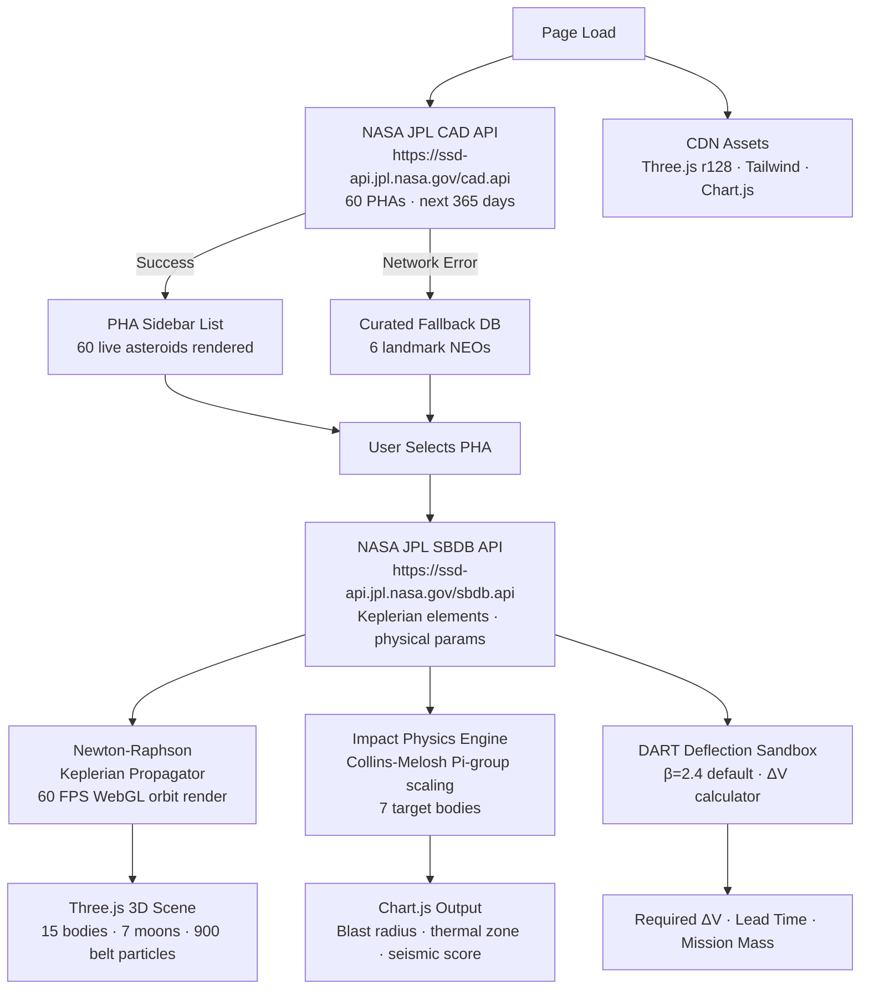

# 📡 NASA Data Integration Guide: AEGIS-NEO
### Technical Architecture & API Specifications — NASA Space Apps Hackathon 2026

---

## Section 1: Live API Integration Status

> **Both NASA JPL API endpoints are ACTIVE and called on every page load.**

| API | Endpoint | Status | Called When |
|:----|:---------|:------:|:------------|
| **NASA JPL CAD API** | `https://ssd-api.jpl.nasa.gov/cad.api` | ✅ **ACTIVE** | Page load — fetches 60 live PHAs |
| **NASA JPL SBDB API** | `https://ssd-api.jpl.nasa.gov/sbdb.api` | ✅ **ACTIVE** | Per selection — loads orbital elements |
| NASA CNEOS Sentry | `https://cneos.jpl.nasa.gov/sentry/` | 📖 Referenced | Risk scale data (Torino/Palermo constants) |
| DART Mission Archives | NASA PDS / JHU-APL | 📖 Referenced | Empirical β constant (2.2–3.6 measured) |

---

### Live Fetch Code — CAD API (Page Load)

```javascript
// Called on DOMContentLoaded — fetches 60 PHAs approaching Earth in next 365 days
async function fetchLivePHAs() {
  const today = new Date().toISOString().split('T')[0];
  const future = new Date(Date.now() + 365 * 864e5).toISOString().split('T')[0];

  const url = `https://ssd-api.jpl.nasa.gov/cad.api` +
              `?date-min=${today}&date-max=${future}` +
              `&dist-max=0.2&h-max=22&sort=dist&limit=60`;

  try {
    const response = await fetch(url);
    const data = await response.json();
    populatePHAList(data.data);   // fields: [des, cd, dist, v_rel, h, ...]
  } catch (err) {
    console.warn('CAD API unavailable — loading curated fallback database');
    loadCuratedFallback();
  }
}
```

---

### Live Fetch Code — SBDB API (Per Selection)

```javascript
// Called when user clicks any PHA in the sidebar list
async function fetchOrbitalElements(designation) {
  const url = `https://ssd-api.jpl.nasa.gov/sbdb.api` +
              `?sstr=${encodeURIComponent(designation)}&phys-par=1&full-prec=1`;

  const response = await fetch(url);
  const data = await response.json();

  const el = data.orbit.elements;
  return {
    a:    parseFloat(el.find(e => e.name === 'a').value),   // semi-major axis (AU)
    e:    parseFloat(el.find(e => e.name === 'e').value),   // eccentricity
    i:    parseFloat(el.find(e => e.name === 'i').value),   // inclination (deg)
    node: parseFloat(el.find(e => e.name === 'om').value),  // RAAN (deg)
    peri: parseFloat(el.find(e => e.name === 'w').value),   // arg. of perihelion (deg)
    moid: parseFloat(data.orbit.moid),                      // min orbit intersection dist (AU)
    diameter: data.phys_par?.find(p => p.name === 'diameter')?.value,
    spec_T:   data.phys_par?.find(p => p.name === 'spec_T')?.value,
  };
}
```

---

## Section 2: NASA JPL CAD API (Close Approach Data)

- **Endpoint**: `https://ssd-api.jpl.nasa.gov/cad.api`
- **Method**: `GET`
- **Authentication**: None required (Public Access)
- **CORS Support**: `Access-Control-Allow-Origin: *`
- **Status in AEGIS-NEO**: ✅ **Implemented** — called on every page load

### Query Parameters Used

| Parameter | Value | Purpose |
|:----------|:------|:--------|
| `date-min` | today's ISO date | Start of search window |
| `date-max` | +365 days | End of search window |
| `dist-max` | `0.2` AU | Maximum close-approach distance |
| `h-max` | `22` | Absolute magnitude limit (size proxy) |
| `sort` | `dist` | Sort by closest approach first |
| `limit` | `60` | Return top 60 PHAs |

### Response Field Mapping

| CAD Field | Meaning | AEGIS-NEO Usage |
|:----------|:--------|:----------------|
| `des` | Designation / name | PHA list label + SBDB lookup key |
| `cd` | Close approach date (UTC) | Timeline marker on orbit view |
| `dist` | Nominal approach distance (AU) | Risk color-coding in sidebar |
| `v_rel` | Relative velocity (km/s) | Impact kinetic energy pre-calculation |
| `h` | Absolute magnitude | Diameter estimate input |

---

## Section 3: NASA JPL SBDB API (Small Body Database)

- **Endpoint**: `https://ssd-api.jpl.nasa.gov/sbdb.api`
- **Method**: `GET`
- **Authentication**: None required (Public Access)
- **CORS Support**: `Access-Control-Allow-Origin: *`
- **Status in AEGIS-NEO**: ✅ **Implemented** — called per PHA selection

### Example Request (99942 Apophis)

```http
GET https://ssd-api.jpl.nasa.gov/sbdb.api?sstr=99942&phys-par=1&full-prec=1 HTTP/1.1
```

### Response Schema & Extraction Mapping

| JSON Field | Astrodynamic Parameter | Units | AEGIS-NEO Usage |
|:-----------|:-----------------------|:------|:----------------|
| `orbit.elements[name=a].value` | Semi-major axis ($a$) | $\text{AU}$ | Ellipse dimensions in 3D canvas |
| `orbit.elements[name=e].value` | Eccentricity ($e$) | dimensionless | Orbital flattening and elongation |
| `orbit.elements[name=i].value` | Inclination ($i$) | $\text{degrees}$ | Ecliptic tilt in Three.js coordinates |
| `orbit.elements[name=om].value` | Longitude of Ascending Node ($\Omega$) | $\text{degrees}$ | Ecliptic longitude rotation |
| `orbit.elements[name=w].value` | Argument of Perihelion ($\omega$) | $\text{degrees}$ | Orientation of orbital ellipse |
| `orbit.moid` | Min. Orbit Intersection Distance | $\text{AU}$ | PHA threshold flag ($<0.05\text{ AU}$) |
| `phys_par[diameter].value` | Equivalent Mean Diameter | $\text{km}$ | Primary input to mass & volume calc |
| `phys_par[spec_T].value` | Tholen / SMASS Spectral Type | text | Bulk density inference (C, S, M, X) |

---

## Section 4: NASA CNEOS Sentry (Close Approach Risk)

- **Service Portal**: `https://cneos.jpl.nasa.gov/sentry/`
- **Status in AEGIS-NEO**: 📖 Referenced — risk scale constants and Torino/Palermo definitions used in UI
- **Primary Function**: Automated collision monitoring system that scans the asteroid catalog for potential future Earth encounters over the next 100 years.

### Hazard Metric Formulations

1. **Torino Scale (0–10)**: Integer scale communicating collision probability and kinetic energy yield to the public. AEGIS-NEO displays Torino ratings for all curated landmark NEOs.

2. **Palermo Technical Impact Hazard Scale ($PS$)**: Logarithmic scale comparing the impact risk of a detected object to the background risk of similar-sized impacts over the intervening years:

$$PS = \log_{10} \left( \frac{P_i}{f_B \cdot \Delta t} \right)$$

Where $P_i$ is impact probability, and $f_B \approx 0.03 \cdot E^{-4/5}$ is the background impact frequency for kinetic energy $E$ in Megatons.

| Palermo Score | Risk Interpretation |
|:-------------|:--------------------|
| $PS < -2$ | Events meriting routine monitoring only |
| $-2 \leq PS < 0$ | Deserves careful monitoring |
| $PS \geq 0$ | Poses risk exceeding background level — action warranted |

---

## Section 5: DART Mission Data Constants

- **Mission**: Double Asteroid Redirection Test (NASA PDCO / JHU-APL)
- **Target**: Dimorphos (moonlet of 65803 Didymos)
- **Impact Date**: September 26, 2022
- **Status in AEGIS-NEO**: ✅ **Implemented** — empirical constants hard-coded in deflection sandbox

### Key Empirical Constants Integrated

| Constant | Value | Source | AEGIS-NEO Usage |
|:---------|:------|:--------|:----------------|
| Spacecraft mass | $570 - 610\text{ kg}$ | DART mission telemetry | Kinetic impactor mass default |
| Impact velocity | $6.6\text{ km/s}$ | Radar astrometry | $\Delta v$ baseline calculation |
| Momentum enhancement $\beta$ | $2.2 - 3.6$ (measured) | Cheng et al. 2023, *Nature* | Default $\beta = 2.4$ in sandbox |
| Orbital period change | $-33\text{ min}$ (net shift) | Optical photometry | Validation benchmark |

### Deflection ΔV Formula (Implemented)

$$\Delta v = \frac{\beta \cdot m_{sc} \cdot v_{rel}}{m_{asteroid}}$$

Where $\beta = 2.4$ (default, user-adjustable), $m_{sc}$ is impactor mass, $v_{rel}$ is relative velocity, and $m_{asteroid}$ is derived from diameter × bulk density by spectral type.

---

## Section 6: Curated Fallback Database

Activated automatically when NASA JPL APIs are unavailable (offline or API downtime). Contains **6 landmark NEOs** with manually verified orbital elements:

| Designation | Name | Diameter | Type | Notes |
|:------------|:-----|:---------|:-----|:------|
| 99942 | Apophis | 370 m | Sq | 2029 flyby at 31,000 km; Torino 4 (2004) |
| 101955 | Bennu | 490 m | B | OSIRIS-REx sample return target |
| 162173 | Ryugu | 870 m | Cg | Hayabusa2 sample return target |
| 1862 | Apollo | 1.5 km | Q | Prototype Apollo-class NEO |
| 433 | Eros | 16.8 km | S | NEAR Shoemaker landing target |
| 65803 | Didymos | 780 m | Sq | DART mission primary body |

All fallback objects retain full physics simulation, impact calculator, and deflection sandbox functionality.

---

## Section 7: Data Flow Architecture



---

## Section 8: Future Integrations

| Integration | API / Source | Priority | Purpose |
|:------------|:-------------|:--------:|:--------|
| NASA Horizons REST API | `https://ssd.jpl.nasa.gov/horizons_batch.cgi` | High | State vectors for N-body perturbation integration |
| NASA NeoWs (NearEarthObjects Web Service) | `https://api.nasa.gov/neo/rest/v1/feed` | Medium | Daily close-approach feed as secondary data source |
| NASA PDCO Risk Table | `https://cneos.jpl.nasa.gov/pd/cs/phaTable.html` | Medium | Real-time Sentry impact probability scores |
| Saturn / Uranus / Neptune | Keplerian elements (JPL) | Medium | Complete outer Solar System visualization |
| ESA NEOCC | `https://neo.ssa.esa.int/` | Low | Cross-validation of risk scores and orbital solutions |
| LSST / Rubin Alert Stream | IVOA VOEvent | Low | Next-generation discovery alert integration |

---

*AEGIS-NEO — Real NASA Data · Real Physics · Zero Install · Open Source*  
*NASA Space Apps Hackathon 2026*
