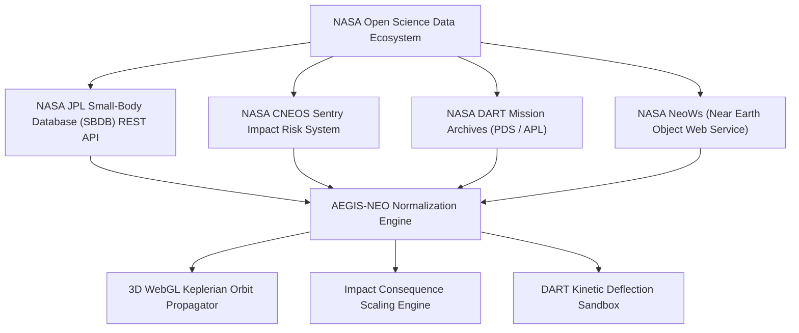

# 📡 NASA Data Integration Guide: AEGIS-NEO
### Technical Architecture & API Specifications for NASA Space Apps Judges

---

## 1. Overview of NASA Open Data Sources

AEGIS-NEO integrates four principal NASA open-data services to drive its planetary defense calculations:



---

## 2. NASA JPL Small-Body Database (SBDB) REST API

- **Base Endpoint**: `https://ssd-api.jpl.nasa.gov/sbdb.api`
- **Method**: `GET`
- **Authentication**: None required (Public Access)
- **CORS Support**: `Access-Control-Allow-Origin: *`

### Parameter Query Example (99942 Apophis)
```http
GET https://ssd-api.jpl.nasa.gov/sbdb.api?sstr=99942&phys-par=1&full-prec=1 HTTP/1.1
```

### Response Schema & Extraction Mapping
| JSON Field | Astrodynamic Parameter | Units | AEGIS-NEO Usage |
| :--- | :--- | :--- | :--- |
| `orbit.elements.a` | Semi-major axis ($a$) | $\text{AU}$ | Defines ellipse dimensions in 3D canvas |
| `orbit.elements.e` | Eccentricity ($e$) | dimensionless | Determines orbital flattening and elongation |
| `orbit.elements.i` | Inclination ($i$) | $\text{degrees}$ | Ecliptic tilt in Three.js camera coordinates |
| `orbit.elements.node` | Longitude of Ascending Node ($\Omega$) | $\text{degrees}$ | Ecliptic longitude rotation |
| `orbit.elements.peri` | Argument of Perihelion ($\omega$) | $\text{degrees}$ | Orientation of the orbital ellipse |
| `orbit.moid` | Minimum Orbit Intersection Distance | $\text{AU}$ | PHA qualification trigger threshold ($<0.05\text{ AU}$) |
| `phys_par.diameter` | Equivalent Mean Diameter ($d$) | $\text{km}$ | Primary input to volume and mass calculations |
| `phys_par.spec_T` | Tholen / SMASS Spectral Type | text | Bulk density inference (C, S, M, X types) |

---

## 3. NASA CNEOS Sentry Technical Impact Hazard Table

- **Service Portal**: `https://cneos.jpl.nasa.gov/sentry/`
- **Primary Function**: Automated collision monitoring system that scans the asteroid catalog for potential future Earth encounters over the next 100 years.

### Hazard Metric Formulations
1. **Torino Scale ($0 - 10$)**: Integer scale communicating collision probability and kinetic energy yield to the public.
2. **Palermo Technical Impact Hazard Scale ($PS$)**: Logarithmic scale comparing the impact risk of a detected object to the background risk of similar-sized impacts over the intervening years:
   $$PS = \log_{10} \left( \frac{P_i}{f_B \cdot \Delta t} \right)$$
   Where $P_i$ is impact probability, and $f_B \approx 0.03 \cdot E^{-4/5}$ is the background impact frequency for kinetic energy $E$ in Megatons.

---

## 4. NASA DART Mission Telemetry & Empirical Constants

- **Mission**: Double Asteroid Redirection Test (NASA Planetary Defense Coordination Office / JHU-APL)
- **Target**: Dimorphos (Moonlet of 65803 Didymos)
- **Impact Date**: September 26, 2022
- **Key Empirical Constants Integrated**:
  - Spacecraft mass at impact: $m_{\text{sc}} \approx 570 - 610\text{ kg}$
  - Impact relative velocity: $v_{\text{rel}} \approx 6.6\text{ km/s}$ ($24,000\text{ km/h}$)
  - Momentum Enhancement Factor ($\beta$): Measured empirically between **$2.2$ and $3.6$** due to ejecta recoil.
  - Orbital Period Shift: Reduced Dimorphos's orbital period from 11 hours 55 minutes by **33 minutes** (far exceeding NASA's minimum baseline threshold of 73 seconds).

---

## 5. NASA NeoWs (Near Earth Object Web Service)

- **Endpoint**: `https://api.nasa.gov/neo/rest/v1/feed`
- **Query Format**: `?start_date=YYYY-MM-DD&end_date=YYYY-MM-DD&api_key=DEMO_KEY`
- **Output**: Daily feed of approaching asteroids, relative velocities, close-approach timestamps, and estimated minimum/maximum diameter bounds derived from absolute magnitude $H$.
