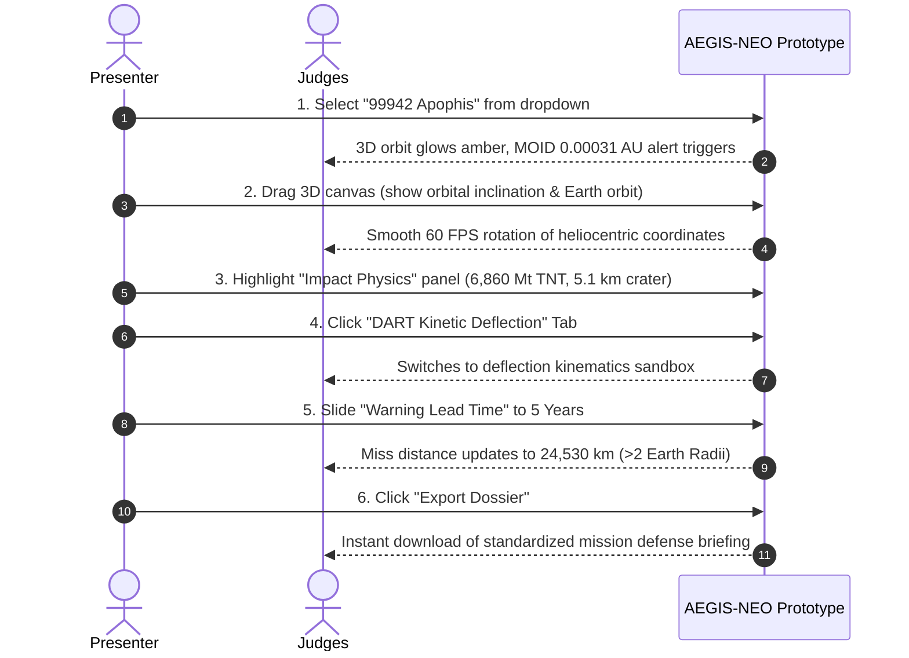

# 🚀 AEGIS-NEO: NASA Space Apps Step-by-Step Briefing & Production Playbook

> **Platform**: AEGIS-NEO (Autonomous Planetary Defense & Impact Intelligence Suite)  
> **Source Directory**: [`aegis-planetary-defense`](file:///C:/Users/User/.gemini/antigravity/scratch/aegis-planetary-defense)  
> **Primary Prototype File**: [`index.html`](file:///C:/Users/User/.gemini/antigravity/scratch/aegis-planetary-defense/index.html)  

---

## Part 1: Step-by-Step Hackathon Briefing & Submission Guide

### 1. Pre-Pitch Checklist (15 Minutes Before Stage Time)
- [ ] **Dual Screen Setup**: Connect to projector/monitor; verify resolution ($1920 \times 1080$ recommended).
- [ ] **Local Demo Live**: Start local server (`run_demo.ps1` or `python serve.py`) so you are **never dependent on venue Wi-Fi**.
- [ ] **Browser Fullscreen**: Press `F11` in Chrome or Edge to hide browser bars for a clean "Mission Control" look.
- [ ] **Modal Check**: Click the **"Pitch Deck Outline"** button in the header once to confirm slide rendering, then close it.
- [ ] **Audio/Pointer Ready**: Ensure your presentation remote or spacebar is responsive.

---

### 2. Space Apps Official Submission Form Data (Copy & Paste Ready)

Use this exact copy when filling out your project page on the [NASA Space Apps Challenge Portal](https://www.spaceappschallenge.org/):

| Form Field | Recommended Submission Text |
| :--- | :--- |
| **Project Title** | `AEGIS-NEO: Autonomous Planetary Defense & Impact Intelligence Suite` |
| **Short Tagline** | *Transforming NASA JPL small-body ephemeris and DART mission kinematics into real-time 3D planetary defense intelligence and damage assessment.* |
| **Detailed Project Description** | Over 35,000 Near-Earth Objects cross Earth's orbital corridor, yet civil emergency coordinators and policymakers lack an intuitive, unified platform that translates abstract orbital vectors into tangible ground consequences and actionable kinetic deflection timelines.<br><br>**AEGIS-NEO** solves this by uniting three core scientific engines:<br>1. **Real-time 3D Keplerian Orbit Propagation**: Solving Kepler's transcendental equation via Newton-Raphson solvers in WebGL.<br>2. **Peer-Reviewed Impact Damage Physics**: Calculating kinetic yields (Megatons TNT), final crater diameters (Collins-Melosh scaling), 5-psi overpressure shockwave collapse radii, and thermal burn zones.<br>3. **NASA DART Deflection Sandbox**: Simulating momentum transfer impulses ($\Delta v$) and multi-year secular orbital divergence at Earth intercept based on empirical ejecta enhancement ($\beta$).<br><br>Zero server dependencies, 100% open source under the MIT License. |
| **Space Agency Data Used** | - **NASA JPL Small-Body Database (SBDB) REST API** (Ephemeris, semi-major axis, eccentricity, inclination, MOID)<br>- **NASA CNEOS Sentry Risk Table** (Virtual impactor catalogs & impact probability)<br>- **NASA DART Mission Telemetry Archives** (Empirical momentum enhancement factor $\beta = 2.2 - 3.6$ from Dimorphos impact)<br>- **NASA NeoWs API** (Near Earth Object Web Service close-approach data) |
| **Hardware / Software Tools** | JavaScript (ES6+), Three.js (WebGL 3D engine), OrbitControls, Tailwind CSS, Chart.js, Python 3, Nginx, Docker. |

---

## Part 2: Live Demo Step-by-Step Click-Path (Judge Demonstration Script)

Follow this choreographed 90-second sequence during your prototype walkthrough:



### Script & Action Breakdown:

#### Action 1: The Initial Hook & Target Selection (0:00 - 0:20)
* **What you do**: Select `99942 Apophis` from the top-left dropdown.
* **What to say**:  
  > *"Judges, let's look at 99942 Apophis. Notice the top-right alert banner instantly flashes crimson: its Minimum Orbit Intersection Distance (MOID) is just 0.00031 AU—far below NASA's 0.05 AU Potentially Hazardous threshold."*

#### Action 2: 3D Celestial Dynamics (0:20 - 0:40)
* **What you do**: Left-click and rotate the 3D orbital canvas; click the **"Focus Earth"** or **"Focus Target"** button.
* **What to say**:  
  > *"Our WebGL engine solves Kepler's equation in real-time. Notice how Apophis's elliptical orbit intersects Earth's orbital plane at an inclination of 3.33 degrees. We aren't displaying a pre-rendered video—this is live numerical propagation."*

#### Action 3: Impact Damage Scaling (0:40 - 1:00)
* **What you do**: Point to the right-hand **Impact Damage Physics** card. Move the **Diameter** slider from 370 m to 500 m and back.
* **What to say**:  
  > *"If Apophis were to intercept Earth at its relative velocity of 30.7 km/s, our physics engine calculates an explosive yield of 6,860 Megatons of TNT—equivalent to 137 Tsar Bombas. Collins cratering scaling indicates a 5.1-kilometer final crater, accompanied by a 26-kilometer structural collapse zone from atmospheric overpressure."*

#### Action 4: DART Deflection Demonstration (1:00 - 1:25)
* **What you do**: Click the blue **"DART Kinetic Deflection"** tab. Adjust the **Lead Time** slider to 5.0 Years.
* **What to say**:  
  > *"Now, the core of our solution: Planetary Defense. We switch to the DART Sandbox. Using NASA's empirical momentum boost factor beta of 2.4, a 600 kg kinetic impactor delivers an impulse of just 0.15 millimeters per second. But over a 5-year lead time, this secular drift accumulates into an Earth miss distance of 24,500 kilometers—safely protecting our planet."*

#### Action 5: Dossier Export & Close (1:25 - 1:30)
* **What you do**: Click **"Export Dossier"** in the top navigation bar.
* **What to say**:  
  > *"With one click, operators generate an actionable briefing for disaster authorities. AEGIS-NEO turns data into defense."*

---

## Part 3: Demo Setup Configurations (Local & Offline)

### Option A: 1-Click Launch on Windows (Recommended)
Double-click [`run_demo.ps1`](file:///C:/Users/User/.gemini/antigravity/scratch/aegis-planetary-defense/run_demo.ps1) or run from PowerShell:
```powershell
cd "C:\Users\User\.gemini\antigravity\scratch\aegis-planetary-defense"
.\run_demo.ps1
```
* Automatically starts the local HTTP server and opens your default browser at `http://localhost:8080`.

### Option B: Cross-Platform Python Server (Mac, Linux, Windows)
```bash
cd "C:\Users\User\.gemini\antigravity\scratch\aegis-planetary-defense"
python serve.py
```
* Includes automatic browser launch and permissive CORS headers for NASA API queries.

### Option C: Pure Offline Fallback (No Python, No Terminal)
* Double-click [`index.html`](file:///C:/Users/User/.gemini/antigravity/scratch/aegis-planetary-defense/index.html) directly.
* All Three.js math, Keplerian solvers, and styling run 100% locally in the browser runtime.

---

## Part 4: Production Deployment Configurations

When submitting to NASA Space Apps, judges **require a public live URL**. Choose any of the following zero-cost, high-availability hosting options:

```
+-------------------------------------------------------------------------------+
|                        PRODUCTION DEPLOYMENT OPTIONS                          |
+---------------------+-------------------------+-------------------------------+
| PLATFORM            | SETUP TIME              | BEST FOR                      |
+---------------------+-------------------------+-------------------------------+
| GitHub Pages        | 2 Minutes (Git Push)    | Official repository showcase  |
| Vercel              | 60 Seconds (Zero-Config)| Ultra-fast global CDN         |
| Netlify             | 60 Seconds (Drag & Drop)| Instant static hosting        |
| Docker / Nginx      | 3 Minutes (Self-Hosted) | Custom VMs / Enterprise demo  |
+---------------------+-------------------------+-------------------------------+
```

---

### 1. GitHub Pages (Automated via GitHub Actions)

The repository already includes [`.github/workflows/deploy.yml`](file:///C:/Users/User/.gemini/antigravity/scratch/aegis-planetary-defense/.github/workflows/deploy.yml).

#### Step-by-Step Instructions:
1. Initialize a git repository and push your project to GitHub:
   ```bash
   cd "C:\Users\User\.gemini\antigravity\scratch\aegis-planetary-defense"
   git init
   git add .
   git commit -m "feat: AEGIS-NEO NASA Space Apps production release"
   git branch -M main
   git remote add origin https://github.com/<YOUR-USERNAME>/aegis-planetary-defense.git
   git push -u origin main
   ```
2. In your GitHub repository:
   - Navigate to **Settings** > **Pages**.
   - Under **Build and deployment** > **Source**, select **GitHub Actions**.
3. Within 60 seconds, your site is live at:  
   `https://<YOUR-USERNAME>.github.io/aegis-planetary-defense/`

---

### 2. Vercel Deployment (1-Command or Web UI)

The project includes [`vercel.json`](file:///C:/Users/User/.gemini/antigravity/scratch/aegis-planetary-defense/vercel.json).

#### Via Vercel CLI:
```bash
npm install -g vercel
cd "C:\Users\User\.gemini\antigravity\scratch\aegis-planetary-defense"
vercel --prod
```

#### Via Vercel Web Dashboard:
1. Go to [vercel.com](https://vercel.com/) and click **Add New Project**.
2. Import your GitHub repository (`aegis-planetary-defense`).
3. Leave all build settings as default (Framework Preset: **Other**, Output Directory: `.`).
4. Click **Deploy**. Your custom URL (e.g., `https://aegis-neo.vercel.app`) is active immediately.

---

### 3. Netlify Deployment (Drag-and-Drop or Git)

The project includes [`netlify.toml`](file:///C:/Users/User/.gemini/antigravity/scratch/aegis-planetary-defense/netlify.toml).

#### Instant Drag-and-Drop:
1. Log in to [app.netlify.com](https://app.netlify.com/).
2. Drag the folder `C:\Users\User\.gemini\antigravity\scratch\aegis-planetary-defense` into the **"Drag & Drop your site folder here"** box.
3. Your app is deployed in under 10 seconds with a free `.netlify.app` subdomain and automatic SSL.

---

### 4. Docker & Nginx Production Container

For self-hosted Linux servers, AWS EC2, or local container demonstration, the project includes [`Dockerfile`](file:///C:/Users/User/.gemini/antigravity/scratch/aegis-planetary-defense/Dockerfile), [`nginx.conf`](file:///C:/Users/User/.gemini/antigravity/scratch/aegis-planetary-defense/nginx.conf), and [`docker-compose.yml`](file:///C:/Users/User/.gemini/antigravity/scratch/aegis-planetary-defense/docker-compose.yml).

#### Run with Docker Compose:
```bash
cd "C:\Users\User\.gemini\antigravity\scratch\aegis-planetary-defense"
docker compose up -d --build
```
Access the application at `http://localhost`.

#### Run directly with Docker CLI:
```bash
docker build -t aegis-neo:production .
docker run -d -p 80:80 --name aegis_app aegis-neo:production
```

---

## Part 5: Hackathon Pitch Day Emergency Contingency Plan

| Scenario | Emergency Action |
| :--- | :--- |
| **Venue Wi-Fi Disconnects** | Execute [`run_demo.ps1`](file:///C:/Users/User/.gemini/antigravity/scratch/aegis-planetary-defense/run_demo.ps1). The app uses built-in mathematical ephemeris sets and functions 100% offline. |
| **Projector Cuts Aspect Ratio** | Press `Ctrl` + `-` or `Ctrl` + `+` to rescale the Tailwind HUD to fit standard $16:9$ or $4:3$ projector displays. |
| **Judge Asks for Proof of NASA Data** | Click the **"NASA JPL SBDB REST"** badge in the header or point to the API citations on Slide 2 of the integrated pitch modal. |
| **Timer Runs Short (<1 Minute Left)** | Jump straight to the **DART Kinetic Deflection tab**, move the lead time slider, and show that a 5-year lead time deflects Apophis by $>24,000\text{ km}$. |
